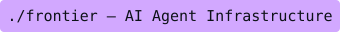

<div align="center">

<a href="https://github.com/xiatiandeairen">

</a>

<a href="https://skillicons.dev"></a>
&nbsp;&nbsp;


</div>

---

### `$ cat /etc/profile`

```yaml
# ╔════════════════════════════════════════════════════════════════════╗

#   ✗ Build AI models    ✗ Write prompts    ✗ Fine-tune LLMs

  I build the missing infrastructure between AI models
  and real-world tasks. The layer underneath —

    execution engines:      "run structured tasks, not vibes"
    persistent memory:      "agents that remember across sessions"
    structured debugging:   "diagnose, not guess"
    system awareness:       "know when to build, when to back off"

  Background: "OS kernels in Rust · cross-platform apps · dev tools"
  Focus:      "AI agent infrastructure"

# ╚════════════════════════════════════════════════════════════════════╝
```

---

### `$ tree ~/work`

<table>
<thead><tr><th width="80"></th><th width="200">Project</th><th>What & Why</th><th width="90"></th></tr></thead>
<tbody>
<!-- ./frontier — AI Agent Infrastructure -->
<tr><td colspan="4"></td></tr>
<tr><td></td><td>agent-verify</td><td>Requirements → a few precise cases → unit / integration / UI verification with reports <br/>   </td><td></td></tr>
<tr><td></td><td><a href="https://github.com/xiatiandeairen/agent-build">agent-build</a></td><td>Fast Xcode &amp; Cargo builds when many agents work in many worktrees — one build slot, warm caches <br/>   </td><td></td></tr>
<tr><td></td><td><a href="https://github.com/xiatiandeairen/agent-quay">agent-quay</a></td><td>Local queue &amp; device lender for parallel agent sessions — builds take turns, simulators and test accounts go to one agent at a time <br/>   </td><td></td></tr>
<!-- ./craft — Systems & Tooling -->
<tr><td colspan="4"></td></tr>
<tr><td></td><td>dotfiles</td><td>Reproducible dev environment — GNU Stow managed setup with bootstrap/doctor workflow and shared rules for Claude/Codex <br/>   </td><td></td></tr>
<tr><td></td><td>x-post</td><td>Write X posts that sound human — patterns learned from real high-performing samples, refined by your own results <br/>   </td><td></td></tr>
</tbody>
</table>

---

### `$ uptime`

<div align="center">

<picture>
  <source media="(prefers-color-scheme: dark)" srcset="https://raw.githubusercontent.com/xiatiandeairen/xiatiandeairen/output/github-snake-dark.svg" />
  <source media="(prefers-color-scheme: light)" srcset="https://raw.githubusercontent.com/xiatiandeairen/xiatiandeairen/output/github-snake.svg" />
  
</picture>

</div>

---

### `$ history`

<details>
<summary><code>展开查看技术成长时间线 ▶</code></summary>

<br>

```
2018  git init life.git             # 开始在 GitHub 上留下痕迹
  │
  ├── 读源码、fork 优秀项目、建立技术品味
  │
2020  rustc hello_kernel.rs          # 用 Rust 写第一个 OS kernel
  │
  ├── 理解中断、内存管理、调度器
  ├── 从此相信：想用好工具，先理解机器
  │
2023  cargo build --release hula     # 第一个独立产品：跨平台 IM
  │
  ├── Tauri + Vue3，从架构到交付全栈负责
  ├── 学到：做产品和写代码是两件事
  │
2025  npm publish smart-commit       # 开始造开发者工具
  │
  ├── 发现 AI agent 的真正瓶颈不是模型，是基础设施
  ├── 没有执行引擎、没有记忆、没有调试框架
  │
2026  aq run -- agb xcodebuild build # All in AI agent infrastructure
  │
  ├── 一台 Mac 上多个 agent 并行，瓶颈从模型变成了机器
  ├── agent-quay:   编译排队，模拟器/真机/测试账号按需借还
  ├── agent-build:  多 worktree 共用构建槽，增量和编译缓存不丢
  └── agent-verify: 需求 → 少而准的用例 → 三层验证与报告

      "每一层都是上一层的地基。"
```

</details>

---

### `$ neofetch`

<details>
<summary><code>展开查看系统信息 ▶</code></summary>

<br>

```
                                        tx@dev
        ████████████████                ──────────────
      ██                ██              OS:       macOS (btw i use terminal)
    ██    ██        ██    ██            Shell:    zsh + custom workflow
    ██                    ██            Editor:   Neovim
    ██    ██████████      ██            Theme:    Clean White
      ██                ██              ─────────────────────────────
        ████████████████                Languages: Rust, TypeScript, Python,
                                                   Shell, Lua
                                        ─────────────────────────────
                                        Interests: OS internals, AI agents,
                                                   dev tooling, photography
                                        Motto:     Build deep. Ship real.
                                                   Push forward.
                                        ─────────────────────────────
                                        Fun fact:  This profile is co-authored
                                                   with an AI agent.
```

</details>

---

### `$ cat /dev/random | head -1`

<details>
<summary><code>展开查看随机想法 ▶</code></summary>

<br>

> "AI 不会取代程序员，但会取代不理解 AI 的程序员。
> 不过，AI 也不会取代理解机器的程序员——
> 因为总得有人给 AI 写基础设施。"

> "最好的工具是你感觉不到它存在的工具。
> 最好的基础设施是你不需要思考它的基础设施。
> 我做的就是这种东西。"

> "写 OS kernel 教会我一件事：
> 所有上层的优雅，都建立在下层的残酷之上。
> 理解残酷，才能设计优雅。"

</details>

---

<div align="center">

*The best tool is the one that disappears into your workflow.*

*If you've scrolled this far — maybe we should talk.*

<!-- 社交链接占位 — 取消注释并填入你的信息 -->
<!-- [](https://your-blog.com) -->
<!-- [](https://twitter.com/handle) -->
<!-- [](mailto:your@email.com) -->

</div>
